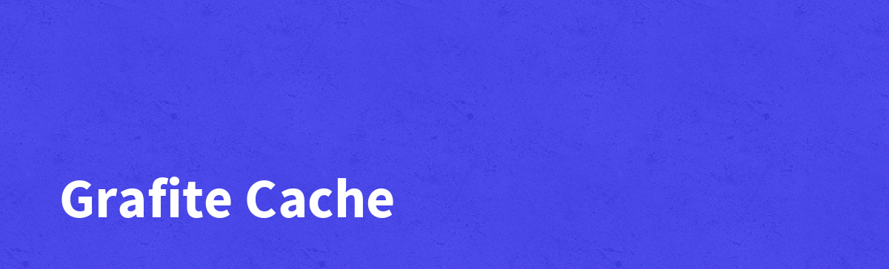

**Cache** - SQLite based cache driver with some fancy extras like tagging and encryption etc.

[](https://github.com/GrafiteInc/Charts/actions/workflows/php-package-tests.yml)
[](https://qlty.sh/gh/GrafiteInc/projects/Cache)
[](https://packagist.org/packages/grafite/cache)
[](https://packagist.org/packages/grafite/cache)

The Cache package an SQLite based cache driver with some fancy extras like tagging and encryption.

##### Author(s):
* [Matt Lantz](https://github.com/mlantz) ([@mattylantz](http://twitter.com/mattylantz), mattlantz at gmail dot com)

## Requirements

1. PHP 8.2+

## Compatibility and Support

| Laravel Version | Package Tag | Supported |
|-----------------|-------------|-----------|
| ^11.x | 1.x | yes |
| ^12.x | 1.x | yes |
| ^13.x | 1.x | yes |

### Installation

Start a new Laravel project:
```php
composer create-project laravel/laravel your-project-name
```

Then run the following to add Support
```php
composer require "grafite/cache"
```

Append to the `cache.php` config file in the stores array:
```php
'sqlite' => [
    'driver' => 'sqlite',
    'table' => 'cache',
    'database' => env('CACHE_DATABASE', database_path('cache.sqlite')),
    'prefix' => '',
    'encrypted' => false,

    // Concurrency settings (these are the defaults, omit them to keep them)
    'busy_timeout' => 10000,
    'journal_mode' => 'wal',
    'synchronous' => 'normal',
    'transaction_mode' => 'IMMEDIATE',
],
```

### Multiple workers

The cache connection ships with settings that let several processes (queue workers, Horizon, web requests) share one SQLite file without `database is locked` errors:

| Key | Default | What it does |
|-----|---------|--------------|
| `busy_timeout` | `10000` | Milliseconds a connection waits for a lock before failing. |
| `journal_mode` | `wal` | Write-ahead logging: readers don't block the writer and the writer doesn't block readers. |
| `synchronous` | `normal` | Safe with WAL and much faster than `full`. |
| `transaction_mode` | `IMMEDIATE` | Takes the write lock at the start of `increment`/`decrement` (used by rate limiters), so contending workers wait their turn instead of failing. Accepts `DEFERRED`, `IMMEDIATE` or `EXCLUSIVE`. |

Set any of these to `null` to leave SQLite's own default in place. `transaction_mode` is applied on every supported Laravel and PHP version. Laravel 12+ on PHP 8.4+ handles it natively, and the package handles it everywhere else.

WAL notes:
- SQLite creates `cache.sqlite-wal` and `cache.sqlite-shm` next to the database. The directory must be writable by every user that runs a worker. If you delete the cache database by hand, delete those two files too.
- WAL does not work on network filesystems (NFS, SMB). Keep the cache file on local disk.

If your **queue** also uses SQLite (`QUEUE_CONNECTION=database` with an SQLite connection), that connection belongs to your app, not this package. Add the same keys to `database.connections.sqlite` in `config/database.php`. Laravel only honours `transaction_mode` there on Laravel 12+ with PHP 8.4+.

## Documentation

[https://documentation.grafite.ca/docs/utilities-cache](https://documentation.grafite.ca/docs/utilities-cache)

## License
Support is open-sourced software licensed under the [MIT license](http://opensource.org/licenses/MIT)

### Bug Reporting and Feature Requests
Please add as many details as possible regarding submission of issues and feature requests

### Disclaimer
THE SOFTWARE IS PROVIDED "AS IS", WITHOUT WARRANTY OF ANY KIND, EXPRESS OR IMPLIED, INCLUDING BUT NOT LIMITED TO THE WARRANTIES OF MERCHANTABILITY, FITNESS FOR A PARTICULAR PURPOSE AND NONINFRINGEMENT. IN NO EVENT SHALL THE AUTHORS OR COPYRIGHT HOLDERS BE LIABLE FOR ANY CLAIM, DAMAGES OR OTHER LIABILITY, WHETHER IN AN ACTION OF CONTRACT, TORT OR OTHERWISE, ARISING FROM, OUT OF OR IN CONNECTION WITH THE SOFTWARE OR THE USE OR OTHER DEALINGS IN THE SOFTWARE.
